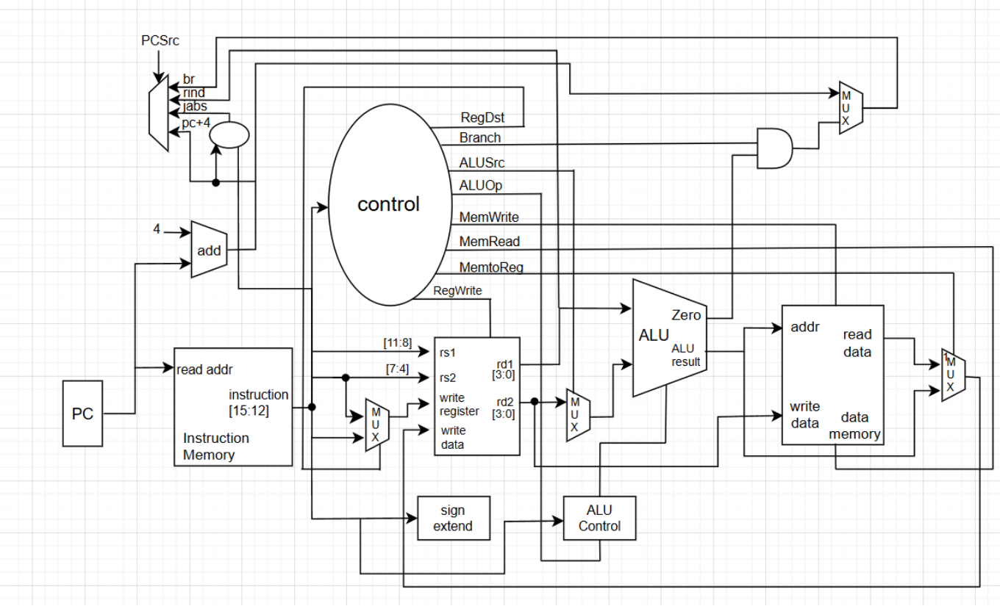

# 8-bit Microprocessor in Verilog

An 8-bit microprocessor written in Verilog, together with a Python assembler that translates assembly programs into machine code, and a testbench for simulation. Example programs include factorial and the sum of 1 to N.

## Table of Contents

- [Features](#features)
- [Architecture](#architecture)
- [Instruction Format](#instruction-format)
- [Instruction Set](#instruction-set)
- [Project Structure](#project-structure)
- [Usage](#usage)
- [Example Programs](#example-programs)
- [Current Status and Known Limitations](#current-status-and-known-limitations)
- [License](#license)
- [Author](#author)

## Features

- 8-bit data path, 16 registers (R0-R15), and a 32-word main memory (5-bit address)
- Control Unit implemented as a Finite State Machine (FSM) with a program counter
- ALU supporting add, subtract, multiply, and compare, with flags (Carry, Borrow, Zero, Greater-or-Equal)
- Python assembler with label support for `JUMP` instructions
- Testbench for simulating and checking the factorial program

## Architecture


| Module | Description |
|---|---|
| `microprocessor` | Top-level module connecting the CU, EU, and memory |
| `CU` | Control Unit: fetches and decodes instructions and generates control signals with an FSM |
| `EU` | Execution Unit: holds the 16 registers and interfaces with the ALU |
| `ALU` | Computes results from the 3-bit `ctrl` signal and produces the flags |
| `mainmemory` | 32 x 8-bit RAM |

**Reserved registers:** during ALU operations the CU uses `R0` and `R1` to hold the operands, and the ALU result is written to `R2` continuously. Programs should therefore keep their own data in `R3-R15`.

### Flags

| Bit | Meaning |
|---|---|
| `flag[0]` | Carry (from addition) |
| `flag[1]` | Borrow (from subtraction) |
| `flag[3]` | Zero (result is 0) |
| `flag[4]` | Greater-or-Equal (A >= B, set by `CMP`) |

## Instruction Format

Each instruction is 19 bits wide.

| Bits | `[18:15]` | `[14:10]` | `[9:5]` | `[4:0]` |
|---|---|---|---|---|
| Field | opcode | operand 1 | operand 2 | operand 3 |

| Instruction type | Operand usage |
|---|---|
| ALU (`ADD`, `SUB`, ...) | op1 = destination, op2 = source A, op3 = source B |
| `LDI` | op1 = destination register, `ins[7:0]` = 8-bit immediate |
| `JUMP` | op1 = condition, op2 = target address |
| `CMP` | op2 = A, op3 = B (result is stored in the flags) |
| opcode `0000` | Halt / NOP |

## Instruction Set

Syntax: `Opcode Operand1 Operand2 Operand3`. A label can be placed before an instruction as `name:`.

| Instruction | Opcode | Example | Description |
|---|---|---|---|
| `LOAD` | `0001` | `LOAD R1 M3` | Load from memory into a register |
| `STORE` | `0010` | `STORE R6 M1` | Store a register into memory |
| `MOV` | `0011` | `MOV R4 R5` | Copy a value between registers |
| `LDI` | `0100` | `LDI R3 10` | Load an immediate value into a register |
| `JUMP` | `0101` | `JUMP G LOOP1` | Jump to a label depending on a condition |
| `ADD` | `1000` | `ADD R3 R3 R5` | R3 = R3 + R5 |
| `SUB` | `1001` | `SUB R5 R5 R4` | R5 = R5 - R4 |
| `AND` | `1010` | `AND R3 R4 R5` | Bitwise AND |
| `OR` | `1011` | `OR R3 R4 R5` | Bitwise OR |
| `SL` | `1100` | `SL R3 R4 R5` | Shift left |
| `SR` | `1101` | `SR R3 R4 R5` | Shift right |
| `CMP` | `1110` | `CMP R4 R11` | Compare; sets `flag[4]` when A >= B |
| `MUL` | `1111` | (write directly in machine code) | R(op1) = R(op2) x R(op3) |

**`JUMP` conditions**

| Symbol | Meaning |
|---|---|
| `U` | Unconditional |
| `C` | Carry |
| `B` | Borrow |
| `Z` | Zero |
| `G` | Greater-or-Equal (A >= B) |

## Project Structure

The Verilog file names below are examples; adjust them to match your files.

```
.
├── microprocessor.v     # microprocessor, mainmemory, CU, EU, ALU
├── microclock_tb.v      # Testbench (module microclock_tb)
├── Assembler.py         # Assembler: assembly -> machine code
├── factorial.txt        # Example assembly: factorial (repeated addition)
├── firstn.txt           # Example assembly: sum of 1 to N
├── machinecode.txt      # Machine code loaded by the CU at simulation start
└── README.md
```

## Usage

### Requirements

- Python 3
- A Verilog simulator such as [Icarus Verilog](https://steveicarus.github.io/iverilog/) (`iverilog`, `vvp`), and optionally GTKWave for viewing waveforms

### 1. Assemble a program

```bash
python Assembler.py factorial.txt
```

The assembler always writes its output to `machinecode.txt`, regardless of the input file name, and automatically appends a halt instruction (`0000_00000_00000_00000`).

### 2. Run the simulation

The CU reads `machinecode.txt` with `$readmemb` using a relative path, so run the simulator from the folder that contains this file.

```bash
iverilog -o sim microprocessor.v microclock_tb.v
vvp sim
```

The testbench holds reset for 100 time units, prints the PC, `R3`, `R4`, and the flag while running, and prints the final value of `R4` after 15000 time units.

### Included `machinecode.txt`

The provided file is a hand-written program that computes 3! using the `MUL` instruction. The expected result is `R4 = 6`.

```
R3 = 3, R4 = 1, R5 = 1
loop: R4 = R3 * R4
      R3 = R3 - R5
      CMP R3 R5
      JUMP G -> loop
halt
```

## Example Programs

**`firstn.txt`**: sum of 10 + 9 + ... + 1

```
LDI R5 10
LDI R4 1
LDI R3 0
FIRST: ADD R3 R3 R5
SUB R5 R5 R4
JUMP Z LOOP
JUMP U FIRST
LOOP: STORE R3 M0
```

**`factorial.txt`**: factorial using repeated addition instead of multiplication (the result is kept in `R6` and then stored to `M1` with `STORE`).

## Current Status and Known Limitations

Based on reading the code, the following parts work: `LDI`, `JUMP` (conditions `U` and `G`), `ADD`, `SUB`, `CMP`, and `MUL`. The remaining items are still to do:

- [ ] **`LOAD`, `STORE`, `MOV`:** the assembler can translate them and `mainmemory` exists, but the CU has no states for them yet, so they have no effect at run time. As a result, `factorial.txt` and `firstn.txt`, which use `MOV`/`STORE`, cannot run completely yet.
- [ ] **`JUMP` conditions `C`, `B`, `Z`:** the CU only supports `U` and `G` (so `JUMP Z` in `firstn.txt` does not work yet).
- [ ] **`AND`, `OR`, `SL`, `SR`:** present in the assembler but not implemented in the ALU (the result is 0).
- [ ] **`MUL`:** supported by the ALU but has no mnemonic in the assembler.
- [ ] **`LDI` immediate encoding:** the assembler places the immediate in bits `[9:2]`, but the CU reads it from bits `[7:0]`. These need to be made consistent (the provided `machinecode.txt` follows the format the CU reads).
- [ ] **Meaning of `G`:** the hardware sets `flag[4]` when A >= B (not A > B). Be careful when writing loop conditions; for example, `CMP R4 R11` with `R11 = 0` is always true for unsigned values.

## License

Specify the project license here (for example MIT) and add a `LICENSE` file.

## Author

- Name: your name
- GitHub: [@username](https://github.com/username)
